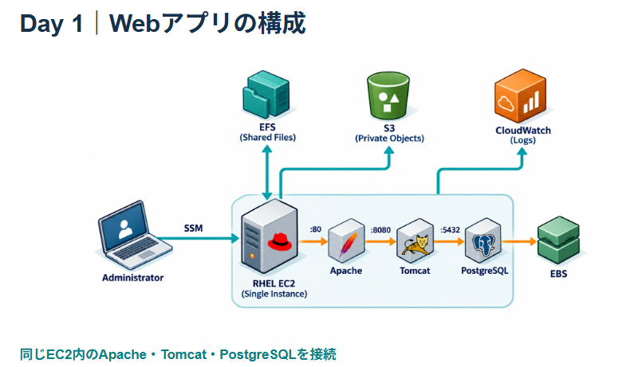
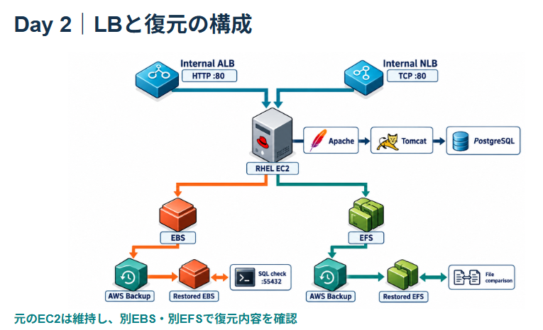
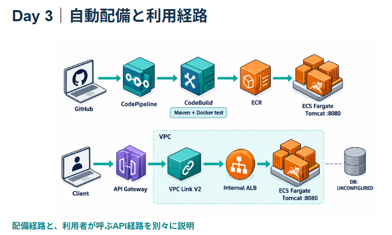
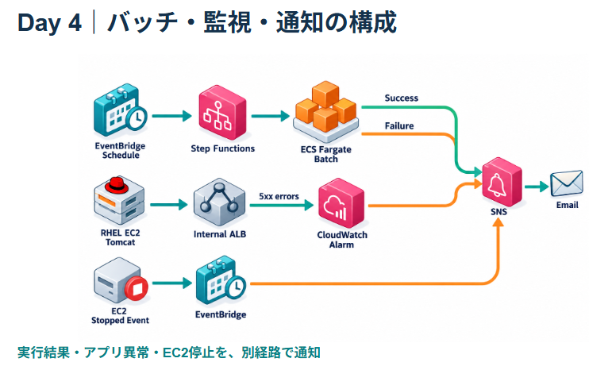

# AWS Infrastructure & DevOps Portfolio

**RHEL上のApache・Tomcat・PostgreSQLから、ECSのコンテナ配備・GitHub連携のCI/CD・API Gateway・非同期バッチ通知と障害復旧まで段階的に検証した学習ポートフォリオです。**

実施日: **2026-10-26〜29** ｜ リージョン: **東京 / ap-northeast-1** ｜ 公開範囲: **Day 1〜4の実施分（Aurora移行・CodeDeployは保留）**

> **Day 4 Terraform再現・終了確認:** [コードと手順](terraform/day4/README.md) / [実施結果](docs/day4-terraform-result.md)。24リソースを再構築し、成功・失敗・定期起動の通知、Tomcat障害復旧、EC2停止通知を再検証しました。検証後は追加分を削除し、EC2停止と元データ保持を確認しました。

> **Day 4コンソール検証:** [実施記録](docs/day4-console.md) / [定義例](day4/README.md)。SNS実受信、Step Functions → ECSの成功/失敗、EventBridge自動起動、Tomcat停止と復旧、EC2停止通知を確認しました。Day 4追加分は削除し、EC2停止を確認しました。[終了証跡](evidence/day4/cleanup-verification.json)を収録しています。Day 4単独の確定額は未算出です。

> **Day 3 Terraform再構築・終了確認:** [実行結果](docs/day3-terraform-result.md) / [コードと再現手順](terraform/day3/README.md)。コンソール構成の整理後、26リソースを再作成し、コミット起点の自動配備・API 403/200を検証して追加分を削除しました。EC2は停止しています。

> **Day 3コンソール検証済み:** [ECR・CodeBuild・ECS・内部ALB・API統合の検証記録](docs/day3-console.md)。mainへのアプリ変更 → CodePipeline → CodeBuild → ECSの全ステージが成功。公開APIのキーなし403・キーあり200と新しいリリース表示を確認しました。

> **Day 2コンソール実施済み:** [バックアップ復元・ALB/NLB・障害復旧の記録](docs/day2-console.md) / [検証出力](evidence/day2-verification.txt)

> **Day 2もTerraformで復元・検証:** [IaC手順](terraform/DAY2.md) / [適用・復元・終了の記録](docs/day2-terraform-result.md)

> **Terraform対応済み:** [IaCコードと操作手順](terraform/README.md) / [取り込み・適用の実施記録](docs/terraform-result.md)

> 最初に読む資料: [Day 1〜4の設計・試験ドキュメント](docs/design-documents/README.md) ／ [Day 1中心のサマリー](docs/summary.md)

## Day 1〜4の構成図

各画像をクリックすると拡大できます。[構成図の解説と実施範囲](docs/architecture-overview.md)も参照してください。

| Day 1｜Webアプリの構成 | Day 2｜LBと復元の構成 |
|---|---|
|  |  |

| Day 3｜自動配備と利用経路 | Day 4｜バッチ・監視・通知の構成 |
|---|---|
|  |  |

各段階の検証構成を示す模式図です。全構成の同時稼働を示すものではありません。Day 3のコンテナDB接続・Aurora移行・CodeDeploy実配備は未実施です。Day 4の通知発行はStep Functions等が制御します。

[Day 1の詳細構成図（SVG）](assets/architecture.svg)

## Day 1〜4の設計・試験ドキュメント

要件から構成・設定・検証結果までをまとめた[設計書一式と要件対応表](docs/design-documents/README.md)を追加しました。

- [要件定義書](docs/design-documents/requirements.md)：目的・範囲・機能／非機能要件・受入条件
- [基本設計書](docs/design-documents/basic-design.md)：段階別構成・設計理由・通信・運用方式
- [詳細設計書](docs/design-documents/detailed-design.md)：ネットワーク・OS・DB・IAM・CI/CD・通知の設定
- [運用設計書](docs/design-documents/operations-design.md)：役割・点検・監視通知・復元・変更・障害対応・撤去
- [試験仕様書兼結果書](docs/design-documents/test-specification-results.md)：30項目の確認内容・結果・根拠と未実施試験

実施記録を基にした設計演習・レビュー用の文書です。顧客承認済みの業務設計書や、構築前の要件合意を示すものではありません。実装済み・未実施・改善案を区別しています。

## この成果物で確認できること

| 分野 | 実施した内容 | 確認方法 |
|---|---|---|
| ネットワーク | 2 AZ・Public/Private各2サブネット、NATなし | VPC構成・ルート設計 |
| Linux | RHEL更新、systemd、SELinux、firewalld、fstab | 再起動後のOS・サービス・マウント確認 |
| Web / DB | Apache → Tomcat → PostgreSQLのJSPアプリ | HTTP応答とDBの実データを照合 |
| ストレージ | 暗号化EBS・EFS、非公開S3 | マウント・読み書き・S3成果物回収 |
| 運用 | CloudWatchログ4種類、アラーム5件 | 実イベント・メトリクスの到着確認 |
| コンテナ / CI/CD | ECR / CodeBuild / CodePipeline / ECS Fargate / 内部ALB | コミットから全ステージ成功・新しいリリースのHTTP 200 |
| 非同期・通知 | Step Functions / ECSバッチ / EventBridge / SNS | 成功・終了コード42の失敗・定期起動・メール受信 |
| 障害演習 | Tomcat停止 / ALB 5xx / CloudWatch / SNS | HTTP 200→503×36→200、DB接続復旧、ALARMメール |
| API | REST API / VPC Link V2 / 使用量プラン・キー | 内部テスト200、公開HTTPSのキーなし403・キーあり200 |
| IaC | Day 1取り込み、Day 2〜4の再構築・検証・終了 | 実行計画・apply・実測・差分0・AWS残存照合 |
| コスト管理 | 月次予算、EC2停止 | 停止状態・スナップショット完了確認 |

**動作確認結果**

```text
Day 1: Apache -> Tomcat -> PostgreSQL OK
```

この表示はJSPからPostgreSQLのテーブルを読み出した結果です。DB接続を使わない固定HTMLでの疎通確認だけではありません。[実際に回収した応答](evidence/application.html)と[再起動後の検証ログ](evidence/verification.txt)を収録しています。

## 設計のポイント

- 管理接続はSSMを使い、SSHの受信許可を設けません。
- HTTPはVPC内に制限し、ブラウザー確認にはSSMのポート転送を使用します。
- Tomcat・PostgreSQLはループバックで待ち受け、外部から直接接続させません。
- DB用EBSをボリュームIDで識別し、XFS・UUID指定のfstabで永続化します。
- SELinuxはEnforcingを維持します。
- EC2からS3への操作は専用IAMロールを使います。
- 検証後はEC2を停止し、正常停止後のDB用EBSからスナップショットを作成しました。

## 資料とコード

| 資料 | 内容 |
|---|---|
| [Day 1〜4 構成図と解説](docs/architecture-overview.md) | 段階別の図、処理の流れ、実施範囲と制約 |
| [Day 1〜4 設計・試験ドキュメント](docs/design-documents/README.md) | 要件定義・基本設計・詳細設計・運用設計・試験結果と対応表 |
| [サマリー](docs/summary.md) | 目的・実施範囲・成果・説明の要点 |
| [設計判断](docs/design.md) | 通信経路、配置、権限、制約と改善余地 |
| [構築手順](docs/procedure.md) | 実行順序、前提、チェックポイント |
| [検証結果](docs/verification.md) | 実測と証跡の対応・未検証項目 |
| [運用・終了手順](docs/operations.md) | 停止、再開、スナップショット、削除順序 |
| [コスト記録](docs/costs.md) | 課金要素と請求反映の限界 |
| [学びと改善](docs/learnings.md) | IAM・更新時間・永続化の学び |
| [今後の計画](docs/roadmap.md) | Day 2〜4の予定。未実施を明記 |
| [証跡の扱い](evidence/README.md) | マスキング方針・収集元・時点 |
| [構築スクリプト](scripts/) / [JSP](app/index.jsp) | 実行に使用したコードを公開向けに整理 |

## 実施範囲と位置付け

本成果物は学習環境の構築・検証記録です。実務の本番導入実績、可用性保証、負荷試験、復旧目標の達成を示すものではありません。AI支援で構築・記録を行い、AWS APIとサーバーの実行結果をもとに検証しています。

Day 2ではバックアップからのDB・EFS復元、内部ALB/NLB、5xx検知と障害復旧、追加リソースの削除まで実施しました。Aurora移行はFreeプラン維持の方針で保留しています。Day 3ではECR、CodeBuild、ECS Fargate、内部ALB、API Gatewayに加え、GitHubの変更による自動ビルド・ECS配備まで検証しました。公開APIは実呼び出しで403/200を確認しました。CodeDeployとコンテナのDB接続は保留です。Day 4では非同期バッチの成功/失敗通知、自動起動、監視・障害復旧・EC2停止通知を検証しました。現在の終了状態は[Day 4記録](docs/day4-console.md)を参照してください。[Day 3の実施範囲・現在の稼働状態](docs/day3-console.md)を明記しています。2026-10-28にコンソール環境を整理し、Terraformで復元・検証後、Day 3追加分を再び削除しました。EC2は停止し、Day 1の保存領域・証跡と既存GitHub接続を保持しています。[Terraformの実測と終了状態](docs/day3-terraform-result.md)を記録しています。[実施範囲](docs/day2-console.md)と[ロードマップ](docs/roadmap.md)に分けています。

公開版ではアカウントID・実リソースID・IP・ARNなどを置換しています。秘密情報、認証情報、未加工の状態ファイルは含めていません。原本は公開用フォルダーとは別に保管しています。

[公開前の検査結果](docs/publication-checks.md)


