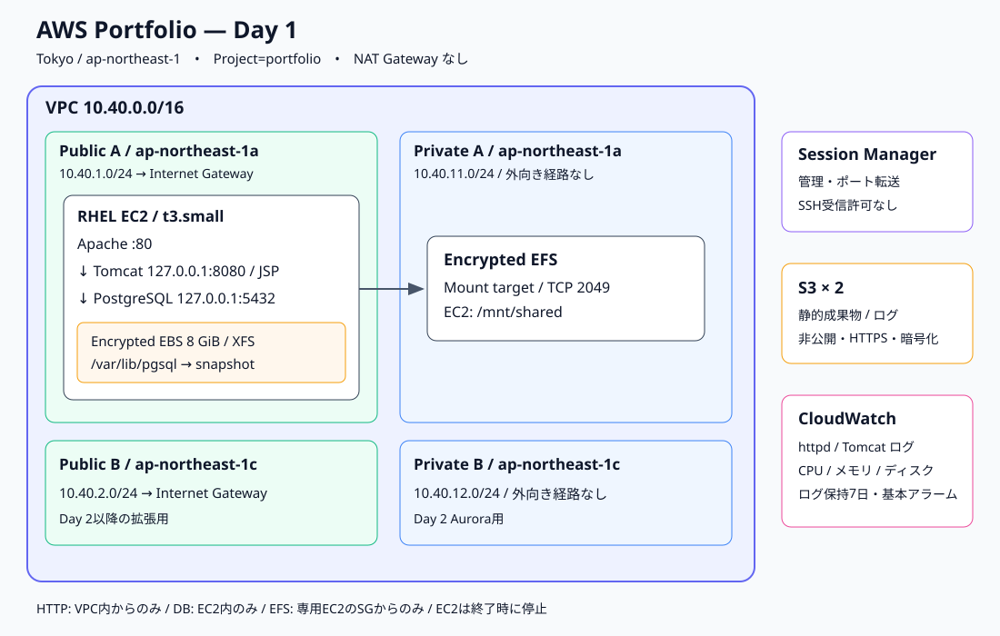

# AWS RHEL Web Application Portfolio

**RHEL上のApache・Tomcat・PostgreSQLをAWSに構築し、再起動後の動作・監視・停止まで検証した学習ポートフォリオです。**

構築日: **2026-10-26** ｜ リージョン: **東京 / ap-northeast-1** ｜ 公開範囲: **Day 1 / Day 2の実施分（Aurora移行は保留）**

> **Day 2コンソール実施済み:** [バックアップ復元・ALB/NLB・障害復旧の記録](docs/day2-console.md) / [検証出力](evidence/day2-verification.txt)

> **Day 2もTerraformで復元・検証:** [IaC手順](terraform/DAY2.md) / [適用・復元・終了の記録](docs/day2-terraform-result.md)

> **Terraform対応済み:** [IaCコードと操作手順](terraform/README.md) / [取り込み・適用の実施記録](docs/terraform-result.md)

> 最初に読む資料: [サマリー](docs/summary.md) → [設計判断](docs/design.md) → [検証結果](docs/verification.md)



## この成果物で確認できること

| 分野 | 実施した内容 | 確認方法 |
|---|---|---|
| ネットワーク | 2 AZ・Public/Private各2サブネット、NATなし | VPC構成・ルート設計 |
| Linux | RHEL更新、systemd、SELinux、firewalld、fstab | 再起動後のOS・サービス・マウント確認 |
| Web / DB | Apache → Tomcat → PostgreSQLのJSPアプリ | HTTP応答とDBの実データを照合 |
| ストレージ | 暗号化EBS・EFS、非公開S3 | マウント・読み書き・S3成果物回収 |
| 運用 | CloudWatchログ4種類、アラーム5件 | 実イベント・メトリクスの到着確認 |
| IaC | Terraformへの取り込み・起動/停止・SSM構成適用 | 実行計画・apply・動作確認 |
| コスト管理 | 月次予算、EC2停止 | 停止状態・スナップショット完了確認 |

**動作確認結果**

```text
Day 1: Apache -> Tomcat -> PostgreSQL OK
```

この表示はJSPからPostgreSQLのテーブルを読み出した結果です。DB接続を使わない固定HTMLでの疎通確認だけではありません。[実際に回収した応答](evidence/application.html)と[再起動後の検証ログ](evidence/verification.txt)を収録しています。

## 設計のポイント

- 管理接続はSSMを使い、SSHの受信許可を設けません。
- HTTPはVPC内に制限し、ブラウザー確認にはSSMのポート転送を使用します。
- Tomcat・PostgreSQLはループバックで待ち受け、外部から直接接続させません。
- DB用EBSをボリュームIDで識別し、XFS・UUID指定のfstabで永続化します。
- SELinuxはEnforcingを維持します。
- EC2からS3への操作は専用IAMロールを使います。
- 検証後はEC2を停止し、正常停止後のDB用EBSからスナップショットを作成しました。

## 資料とコード

| 資料 | 内容 |
|---|---|
| [サマリー](docs/summary.md) | 目的・実施範囲・成果・説明の要点 |
| [設計判断](docs/design.md) | 通信経路、配置、権限、制約と改善余地 |
| [構築手順](docs/procedure.md) | 実行順序、前提、チェックポイント |
| [検証結果](docs/verification.md) | 実測と証跡の対応・未検証項目 |
| [運用・終了手順](docs/operations.md) | 停止、再開、スナップショット、削除順序 |
| [コスト記録](docs/costs.md) | 課金要素と請求反映の限界 |
| [学びと改善](docs/learnings.md) | IAM・更新時間・永続化の学び |
| [今後の計画](docs/roadmap.md) | Day 2〜4の予定。未実施を明記 |
| [証跡の扱い](evidence/README.md) | マスキング方針・収集元・時点 |
| [構築スクリプト](scripts/) / [JSP](app/index.jsp) | 実行に使用したコードを公開向けに整理 |

## 実施範囲と位置付け

本成果物は学習環境の構築・検証記録です。実務の本番導入実績、可用性保証、負荷試験、復旧目標の達成を示すものではありません。AI支援で構築・記録を行い、AWS APIとサーバーの実行結果をもとに検証しています。

Day 2ではバックアップからのDB・EFS復元、内部ALB/NLB、5xx検知と障害復旧、追加リソースの削除まで実施しました。Aurora移行はFreeプラン維持の方針で保留し、ECS・CI/CD・非同期連携は未実施です。[実施範囲](docs/day2-console.md)と[ロードマップ](docs/roadmap.md)に分けています。

公開版ではアカウントID・実リソースID・IP・ARNなどを置換しています。秘密情報、認証情報、未加工の状態ファイルは含めていません。原本は公開用フォルダーとは別に保管しています。

[公開前の検査結果](docs/publication-checks.md)


