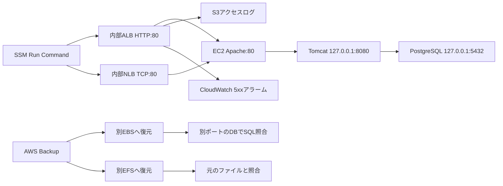

# Day 2：バックアップ復元・負荷分散・障害復旧の実施記録

実施日：2026-10-26 / 東京（ap-northeast-1） / 操作方法：AWSコンソール

**Freeプランで実施できた範囲を検証し、追加リソースの後片付けまで実施しました。Auroraへの移行は保留です。**

## 目的と構成

Day 1のRHEL上のApache → Tomcat → PostgreSQLに、AWS Backupと内部ALB/NLBを追加しました。バックアップジョブの成功だけでなく、復元DBのSQL取得と復元EFSのファイル照合まで確認しました。Day 2の追加分はコンソールで操作しており、Day 1のTerraformコードに追加した実績ではありません。

既存のVPC内HTTP許可を再利用し、インターネット公開とTomcatの待ち受け変更を避けました。NLBの転送先は当初計画のTomcat:8080からApache:80へ変更しています。

## 結果

| 分野 | 実施内容 | 確認結果 |
|---|---|---|
| Backupプラン | portfolio-day2-backup / 日次 / 7日保持 / Defaultボールト | 作成・対象割り当てを確認 |
| バックアップ対象 | DB用EBS 1本・EFS 1個をIDで明示指定 | 全リソース指定を避けて登録 |
| EBSバックアップ | EC2正常停止後 / 暗号化 / 8 GiB | オンデマンドジョブ完了 |
| EFSバックアップ | オンデマンド実行 / 151 B | ジョブ完了 |
| EBS復元 | 同じAZの新規8 GiB gp3・暗号化ボリューム | 復元ジョブ完了 |
| DB復元の検証 | 追加EBSをマウントし、復元DBを127.0.0.1:55432で一時起動 | 元と同じレコードをSQLで取得、終了コード0 |
| EFS復元 | 新しい暗号化ファイルシステムに完全復元 | 復元ジョブ完了 |
| EFS復元の検証 | 同じAZのプライベートサブネットに接続口を作成 / 既存EFS用SG | day1.txtを元ファイルとcmpで照合、一致 |
| ALB | 内部 / IPv4 / 2 AZ / HTTP:80 → Apache:80 | Active・Healthy・JSP応答を確認 |
| NLB | 内部 / IPv4 / 2 AZ / TCP:80 → Apache:80 | HTTP 200・DB由来のJSP応答を確認 |
| ALBアクセスログ | 既存非公開S3のalb/プレフィックスへ配信 | テストファイルと当日の.log.gz到着を確認 |
| CloudWatch | HTTPCode_Target_5XX_CountのSum、60秒、>0、1/1評価 | 障害時の発報と復旧後OKを確認 |

[実行結果の抜粋](../evidence/day2-verification.txt)に、コンソールで確認した出力と時刻を収録しています。

## 実施順序と復元方法

1. AWS Backupで日次プランと7日保持ルールを作成し、DB用EBS・EFSだけを対象に登録しました。既存のAWSBackupDefaultServiceRoleを使いました。
2. EC2の正常停止を確認してEBSをバックアップしました。EFSもオンデマンドバックアップし、両方の完了を確認しました。
3. 元のリソースを上書きせず、新規EBSと新規EFSへ復元しました。
4. 復元EBSを別デバイスで追加接続し、NVMeのシリアルから対象を識別しました。XFSのUUID重複を考慮してnouuidでマウントしました。
5. 復元DBを通常の5432とは別の55432で一時起動し、portfolio DBのlearning_logをSELECTしました。元のPostgreSQLは稼働したままで、検証後に復元DBを停止・アンマウントしました。
6. 復元EFSに同じAZの接続口を作成し、読み取り専用でマウントしました。復元先ディレクトリ配下のday1.txtを見つけ、元の共有ファイルとcmpで照合しました。検証後はアンマウントしました。
7. ALB/NLBの応答確認後、Tomcatだけを一時停止して503を発生させ、再起動後のDB応答と3サービスのactiveを確認しました。
8. 証跡を確認し、承認されたDay 2検証用リソースを削除しました。

## 障害演習の観測

| 時刻（JST） | 観測 |
|---|---|
| 17:14:31 | ALB経由のJSP応答にApache → Tomcat → PostgreSQL OK |
| 17:47:22〜17:48:52 | Tomcat停止中、10秒間隔の10回すべてでHTTP 503 |
| コマンド終了時 | DB応答が回復、httpd・tomcat・postgresqlがactive、FAULT_RECOVERY=PASS |
| 17:50:14 | CloudWatch履歴でOK → アラーム状態 |
| 17:58:14 | CloudWatch履歴でアラーム状態 → OK |

CloudWatchの履歴はUTC表示をJSTへ換算しています。HTTPの復旧時刻とアラーム状態の更新時刻は一致しません。単一の実演から検知時間や復旧時間を保証するものではありません。

アラーム名はportfolio-day2-alb-target-5xx、欠落データはnotBreaching、通知アクションは設定していません。SNSメール通知はDay 4の範囲です。

## ALBとNLBの比較・設計判断

| 観点 | ALB | NLB |
|---|---|---|
| 判断する単位 | HTTPリクエスト | 接続・フロー |
| 今回のリスナー | HTTP:80 | TCP:80 |
| 今回の転送先 | Apache:80 | Apache:80 |
| 確認した結果 | Healthy、JSP応答、ログ、5xx検知 | HTTP 200、JSPのDB取得結果 |
| 学習の焦点 | L7の動作と監視 | L4転送との比較 |

NLBは単一EC2から同じEC2へ戻る経路で確認したため、クライアントIP保持によるヘアピン接続の制約を考慮して設定を変更しました。実通信の成功を確認しています。[AWSのトラブルシューティング](https://docs.aws.amazon.com/elasticloadbalancing/latest/network/load-balancer-troubleshooting.html)を参照してください。

ALBログは初回にS3のAccess Deniedとなったため、ログ配信サービスのPutObject許可を追加しました。同一リージョン・同一アカウントのSourceArn条件と、アカウントIDを含む専用保存先を指定し、有効化成功とログ到着を確認しました。[公式手順](https://docs.aws.amazon.com/elasticloadbalancing/latest/application/enable-access-logging.html)に基づく設定です。終了時には追加許可を除去しています。

## Auroraを保留した理由

このアカウントのFreeプランの作成画面では、計画どおりのプライベートVPC構成を選択できませんでした。ユーザーの方針に従いPaidプランへ変更していません。Auroraは未作成で、データ移行とJDBC切替も未実施です。

当該アカウント・時点で確認した制約であり、全アカウントに共通する仕様とは断定しません。[Aurora無料利用枠の公式情報](https://docs.aws.amazon.com/AmazonRDS/latest/AuroraUserGuide/aurora-free-tier.html)を参照してください。

## 終了状態と費用

| リソース | 終了時の状態 |
|---|---|
| Day 1 EC2 | 停止済みを確認 |
| Day 1の元EBS・EFS・スナップショット・S3 | 保持 |
| Day 2 ALB/NLB | 2台の削除成功と一覧0台を確認 |
| Day 2ターゲットグループ | 一覧0件を確認 |
| 復元用EBS | 通常デタッチ後、削除成功 |
| 復元用EFS・接続口 | 削除成功 |
| 今回の復旧ポイント | 2件とも削除済みを確認 |
| Backupプラン | 設計を保持、リソース割り当て0件 |
| Day 2の5xxアラーム | 削除、詳細画面で不存在を確認 |
| 一時的なS3ログ配信許可 | 追加したSidだけ除去して保存成功 |
| S3アクセスログ・SSM実行履歴 | 証跡として保持 |

Freeプランでも各サービスはクレジットを消費し得ます。今回の確定費用は請求反映待ちで、利用額をゼロとは記載しません。Day 1から保持するEBS・EFS・S3等の保存料金も残ります。

## 検証の限界

- EC2は1台です。正常な別ターゲットへのフェイルオーバー、冗長化、負荷試験は未実施です。
- Aurora移行、SNS通知、Day 2構成のTerraform化は未実施です。
- 画面キャプチャ取得が応答しなかったため、保存したコンソール画像はありません。証跡は確認した画面状態とSSM出力の抜粋・転記です。図は説明用で、画面証跡の代わりとはしていません。
- 公開版からアカウントID・実リソースID・IP・ARN・認証情報を除外しています。

## 後日のIaC検証

このページは2026-10-26のコンソール作業の記録です。2026-10-27には[Terraformでの再作成と復元検証](day2-terraform-result.md)を追加しました。上記の未実施項目はコンソール作業時点の範囲を示しています。

