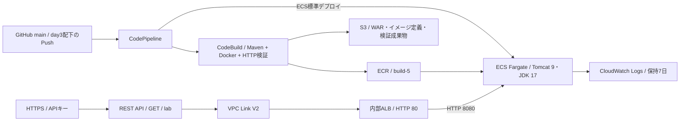

# Day 3 コンソール実施記録

実施日: 2026-10-27 / 東京リージョン / AWS Freeプランを維持。

## 検証結果

GitHubのmainブランチへのアプリ変更を起点に、**CodePipeline → CodeBuild → ECS Fargate**の全ステージが成功しました。公開HTTPS APIから新しいリリース表示も確認しています。

| 確認対象 | 実際に確認した結果 |
|---|---|
| 起点のコミット | 02e02e35562318b3ce86e5dd8fae3eb14500a51e |
| CodePipeline | Source / Build / Deployがすべて成功 |
| CodeBuild | build-5。ソース取得・ビルド・コンテナ起動検証・ECR push・成果物出力が成功 |
| ECS | portfolio-day3-task:3、デプロイ成功、実行中1件・保留中0件 |
| APIキーなし | HTTP 403 |
| APIキーあり | HTTP 200 |
| 配備内容 | AWS Portfolio Day 3 / day3-cicd-v1 |
| DB | DB_STATUS=UNCONFIGURED。コンテナからのDB接続は未設定 |
| 配備後のAPI確認時刻 | 2026-10-27 14:25:45 JST |

CodeBuildのbuild-5ログでは、DOWNLOAD_SOURCE、INSTALL、PRE_BUILD、BUILD、POST_BUILD、UPLOAD_ARTIFACTSの各段階でSUCCEEDEDを確認しました。コンソール表示のUTC時刻は05:22:13〜05:23:12で、日本時間では14:22:13〜14:23:12です。

利用者が停止前にコンソールで結果を確認する希望のため、**この記録時点ではEC2・ECS・内部ALBを稼働させています。停止・削除完了の記録ではありません。**

## 構成

当初のNLB経由構成から、REST APIのVPC Link V2で内部ALBを再利用する構成へ変更しました。[AWSのプライベート統合の説明](https://docs.aws.amazon.com/apigateway/latest/developerguide/private-integration.html)に基づきます。Day 3用のNLBは作成していません。

## 実施内容と設定

| 項目 | 内容 |
|---|---|
| ECR | 非公開 portfolio-day3-tomcat。イメージタグは変更不可 |
| CodeBuild | portfolio-day3-build。Java 17 / MavenでWARを作成し、Docker起動・本文検証後にECRへpush |
| 成果物 | portfolio.war、appspec.yml、配備フック、imagedefinitions.json、build-info.txt、検証時のHTML |
| GitHub接続 | AWS Connectorを今回のリポジトリ1件だけにインストールし、東京で portfolio-day3-github を作成 |
| CodePipeline | portfolio-day3-pipeline。キュー実行。既存の非公開S3を成果物ストアに使用 |
| 自動起動条件 | mainへのPush、変更ファイルがday3/**。提出資料だけの更新による不要な実行を抑制 |
| ECS | Fargate Linux x86_64、0.25 vCPU / 1 GiB。コンテナ名tomcat、8080、非root |
| 通信 | 専用SGはVPC内10.40.0.0/16からの8080のみ許可。内部ALBは既存のVPC内向けSG |
| 外向き通信 | PublicサブネットでタスクのPublic IPを有効化してイメージを取得。インターネットからの受信は許可しない |
| ALB | portfolio-day3-alb。IP型ターゲット、ヘルスチェック /portfolio/health.jsp |
| API Gateway | portfolio-day3-api。GETをVPC Link V2経由で内部ALBの /portfolio/ へプロキシ |
| 使用量プラン | portfolio-day3-usage。毎秒1回、バースト2、100回/日。キーとlabステージを関連付け |
| ログ | ECSとCodeBuildのCloudWatch Logsを保持7日に設定 |

標準ECSデプロイは、サービスが使っているタスク定義をもとに新しいリビジョンを作成します。今回は手動配備のリビジョン2から、パイプラインによってリビジョン3へ更新されました。[AWSのECSデプロイアクション仕様](https://docs.aws.amazon.com/codepipeline/latest/userguide/action-reference-ECS.html)

## IAMと、実行時に修正した権限

CodePipeline専用の portfolio-day3-pipeline-role を作成し、CodePipelineだけを信頼する設定にしました。

- 今回のGitHub接続の利用。
- 既存S3バケットの必要なメタデータ参照と、今回の成果物プレフィックス内の読み書き。
- 既存のportfolio-day3-buildの開始・状態取得。
- 今回のECSサービスの参照・更新。
- タスク定義の参照・登録。AWSの仕様に従い、この2アクションはResource=*。
- 今回のタスク定義への登録時のタグ付け。
- ecsTaskExecutionRoleをECSに渡す操作。iam:PassedToService条件付き。

初回実行では、S3の成果物保存先がパイプライン名から短縮された **portfolio-day3-pipel/** となり、準備したフルネームのパスと一致せずPutObjectが拒否されました。対象をこの実際のプレフィックスに修正し、ソース取得に成功しました。

次に初回のパイプライン経由ビルドがDOWNLOAD_SOURCEで停止しました。既存のCodeBuildロールにはカスタム成果物バケットへの書き込みはありましたが、今回の入力成果物を読む許可がありませんでした。確認・承認のうえ、同じプレフィックスだけにGetObjectとGetObjectVersionを追加しました。書き込み権限は増やしていません。修正後のアプリコミットでbuild-5が成功しました。

公開用の権限例:

- [パイプラインの許可ポリシー](examples/day3-pipeline-policy.json)
- [CodeBuildの成果物読み取りポリシー](examples/day3-codebuild-artifact-policy.json)
- [CodePipeline専用の信頼ポリシー](examples/day3-pipeline-trust.json)

例のACCOUNT_ID・ARTIFACT_BUCKET・CONNECTION_IDはプレースホルダーです。環境の値への置換が必要です。ポリシー例だけで必要な構成がすべて作成されるわけではありません。

## アプリと検証の不具合修正

1. 初回の手動ビルドは11:46〜11:47 JSTに成功しましたが、実際のアプリ画面はHTTP 500でした。一方、ヘルスチェックは200でした。
2. JSPの暗黙変数configとローカル変数が衝突していたため、ローカル変数をdbConfigへ変更しました。
3. 初回のビルド用シェルには、途中のcurl失敗を後続の成功表示が隠す問題もありました。独立したsmoke-test.shでset -euo pipefail、curl -f、本文検査を使う形へ修正しました。
4. 修正後の手動ビルドで実画面を検証し、ECSのリビジョン2へ手動更新しました。
5. アプリにday3-cicd-v1という表示を追加したコミットを作成。main / day3/**の条件でパイプラインが自動起動し、build-5とECSへの配備が成功しました。
6. 配備後の公開APIで、キーなし403・キーあり200・day3-cicd-v1の本文を確認しました。

ヘルスチェック、コンテナ内の実画面、公開経路、配備されたリリースの一致を別々に確認しました。単発の疎通検証であり、負荷試験や可用性試験ではありません。

## APIキーとDBの扱い

APIキーは非表示入力でSSMの検証に渡し、値をGitHubや公開記録に含めていません。コンソール内のメソッドテストは認可処理を迂回するため、実エンドポイントへのcurlで403/200を別途確認しました。

APIキー・使用量プランは呼び出し量の管理用です。利用者の本人認証や厳密な課金上限の代替ではありません。この公開APIは検証用画面だけを返します。

コンテナにはDB接続を設定しておらず、DB_STATUS=UNCONFIGUREDと明示します。Day 1のEC2上のApache → Tomcat → PostgreSQLの動作確認とは区別しています。Day 3のHTTP 200をAurora移行の完了として扱いません。

## 保留項目

- **CodeDeployのEC2配備**: サービスへの移動でサインアップ画面へ転送され、自動承認レビューがプラン・アカウント変更に進む可能性を理由にアクセスを拒否。Freeプラン維持のため保留。appspec.ymlと配備フックは収録していますが、CodeDeployによる実行実績はありません。
- **Aurora移行とコンテナからのDB接続**: 保留。
- **Day 3のTerraform化**: 未実施。
- **停止・削除と最終費用**: 利用者のコンソール確認後に実施・追記。現時点の確定費用は未集計。

## 確認後の終了手順

コンソールで成功結果を確認してから、ECSの希望タスク数を0にし、EC2を停止します。内部ALBなどの検証専用リソースは削除対象を確認して整理し、残るストレージ・ログ・イメージ・成果物の課金も確認します。Day 1のDB用EBS・EFS・元スナップショットは、この終了処理で削除しません。

## 学び

ビルド成功、ヘルスチェック成功、利用者向け画面の正常表示は別の確認です。また、同じS3を使っていても、ソース取得を行うCodePipelineとビルドを行うCodeBuildでは実行ロールが異なります。実際に拒否された操作・対象・実行主体を確かめ、必要な範囲だけを追加することで自動配備を通しました。
