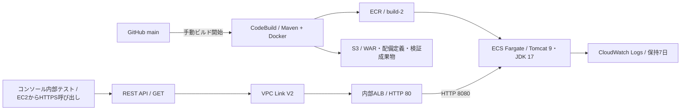

# Day 3 コンソール実施記録（進行中）

実施日: 2026-10-27 / 東京リージョン / AWS Freeプランを維持。

## 検証できた範囲

ECR、CodeBuild、ECS Fargate、内部ALB、REST APIのプライベート統合をコンソールで構築しました。CodeBuildの修正版ビルドが成功し、ECSのタスク定義リビジョン2への更新が成功、正常なタスク1個を確認しました。VPC内からのアプリ応答と、API GatewayコンソールのメソッドテストでHTTP 200を確認しています。

APIキーの作成、labステージへのデプロイ、使用量プランへの関連付けも完了しました。EC2のSSMセッションから公開HTTPSエンドポイントを呼び、キーなし403・キーあり200と画面本文を確認しました。CodePipelineの自動デプロイは未完了です。

## 構成

当初のNLB経由構成から、REST APIのVPC Link V2で内部ALBを再利用する構成へ変更しました。[AWSのプライベート統合の説明](https://docs.aws.amazon.com/apigateway/latest/developerguide/private-integration.html)に基づきます。Day 3用のNLBは作成していません。

## 実施内容

| 項目 | 実施結果 |
|---|---|
| ECR | 非公開リポジトリ portfolio-day3-tomcat。イメージタグを変更不可に設定 |
| CodeBuild | portfolio-day3-build。MavenでWAR作成、Dockerビルド、起動・HTTP検証、ECR push、S3成果物出力 |
| IAM | ビルドロールへECR認証と今回のリポジトリに限定した操作権限を追加 |
| ECS | Fargate Linux x86_64、0.25 vCPU / 1 GiB、コンテナ名 tomcat、ポート8080、非root実行 |
| 通信 | 専用SGでVPC内10.40.0.0/16からの8080だけを許可。内部ALBの80は既存VPC内向けSGを使用 |
| 外向き通信 | PublicサブネットでタスクのPublic IPを有効化。イメージ取得用であり、インターネットからの受信は許可しない |
| ALB | portfolio-day3-alb。IP型ターゲットグループ、ヘルスチェック /portfolio/health.jsp |
| API Gateway | portfolio-day3-api。GETをVPC Link V2経由で内部ALBの /portfolio/ にプロキシ |
| 使用量プラン | portfolio-day3-usage。毎秒1回、バースト2、100回/日。キー・labステージの関連付け完了 |
| CloudWatch | ECSとCodeBuildのログ保持を7日に設定 |

## 実行結果と不具合の修正

1. 初回ビルドは11:46〜11:47 JSTに成功しました。しかし、ECSで実際の画面にアクセスするとHTTP 500でした。ヘルスチェックは200であり、正常判定だけではアプリ画面の正常性を保証できないことが分かりました。
2. 原因はJSPの暗黙変数 config とローカル変数の衝突でした。変数名を dbConfig に変更しました。
3. 初回のビルド用シェルにも、途中のcurl失敗を後続の成功表示が隠す問題がありました。独立した smoke-test.sh で set -euo pipefail を有効にし、curl -f と本文検査が失敗すればビルドも失敗するよう修正しました。
4. 修正版のCodeBuild build-2は成功しました。対象ソースはコミット e95ebe9be85ac4142ae19fe33dce0bf9b048e40f です。
5. ECSをタスク定義リビジョン2へ更新し、更新成功・正常タスク1個・失敗タスク0件をコンソールで確認しました。
6. 内部ALB経由で HTTP 200 と AWS Portfolio Day 3 の本文を確認しました。
7. 12:35 JSTのAPI GatewayコンソールテストもHTTP 200、表示されたレイテンシは14 msでした。これは単発の疎通結果であり、性能試験ではありません。

### DBの状態

コンテナの画面は DB_STATUS=UNCONFIGURED と表示します。コンテナからAurora・PostgreSQLへの接続は未設定です。Day 1のEC2上では従来のApache → Tomcat → PostgreSQLが動作しています。Day 3のHTTP 200をDB移行の完了として扱いません。

### APIの公開・認証

GETメソッドはAPIキー必須に設定し、自動生成した検証用キーを使用量プランへ関連付けました。キーの値は公開していません。公開ステージ lab を作成し、使用量プランを関連付けました。SSM上のcurl検証では NO_KEY_HTTP=403、WITH_KEY_HTTP=200、AWS Portfolio Day 3、DB_STATUS=UNCONFIGURED を確認しました。キーは非表示入力で渡し、ソースや公開記録に含めていません。コンソールテストは認可処理を迂回するため、キーなし403・キーあり200の証明にはなりません。使用量プランの制限は厳密な課金上限や認証の代替ではありません。

## 残作業・制約

- GitHubのAWS Connectorのユーザー認証は承認・完了。利用者から接続完了の連絡を受けましたが、AWS接続一覧とGitHubのインストール一覧には登録がなく、最終インストール画面が残っていることを確認。対象リポジトリ1件を選択し、表示されたリポジトリ権限の最終承認待ちです。
- CodePipelineはソース接続の設定途中で、パイプラインは未作成。コミットによる自動デプロイは未検証。
- CodeDeployへの移動でサインアップ画面へ転送され、自動承認レビューがプラン・アカウント変更に進む可能性を理由にアクセスを拒否。Freeプラン維持のため保留。配備定義・フックはソースとして収録していますが、CodeDeployによる実行実績はありません。
- Auroraへの移行・コンテナからのDB接続は保留。
- Day 3のTerraform化は未実施。

## 終了状態（作業途中）

この記録時点ではEC2が稼働し、ECSの希望タスク数は1、内部ALBも存在します。追加リソースの削除とEC2停止はまだ完了していません。Chrome再接続後にAPIの実呼び出しまで検証しました。利用者が停止前にコンソールで結果を確認する希望のため、稼働を継続し、CodeBuild・ECS・API使用量プラン・SSMの確認画面を残しています。課金ゼロ・作業完了とは扱いません。利用者の確認後に停止・削除へ進み、終了状態を追記します。

## 学び

ビルド成功、ヘルスチェック成功、利用者向け画面の正常表示は別の確認です。実際のコンテナ起動と画面の本文まで確認することで、JSPが最初のアクセス時にコンパイルされる問題を検出できました。失敗を確実にビルドへ伝えるシェルの書き方も、デプロイの品質を左右します。
