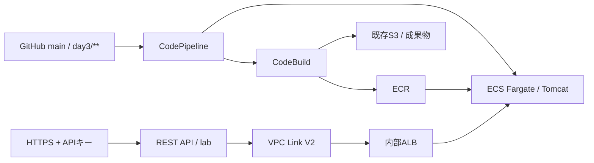

# Day 3：コンソール構成の整理とTerraform再構築

実施日：2026-10-28（東京リージョン、JST）。コンソールでの動作確認後、Day 3の追加リソースを削除し、専用Terraformルートで再作成・再検証して、追加分を再び削除しました。

## 実施範囲

Freeプランを維持し、実際にコンソールで検証できた範囲を再現しました。Aurora移行、CodeDeploy、コンテナからのDB接続、SNS通知は今回の完了対象に含めません。DB表示は `UNCONFIGURED` です。アプリからDBへ接続できたという意味ではありません。

NAT GatewayとNLBは作成しません。Fargateにはイメージ取得用パブリックIPを付け、受信8080はVPC内だけに制限しました。内部ALBは既存のVPC内HTTP受信用SGを参照します。

## 1. コンソールで作った環境の整理

[コンソール実施記録](day3-console.md)を更新し、構成・IAM・実行履歴を非公開で保存しました。2026-10-28 15:55:54 JSTの[終了確認](../evidence/day3-console-cleanup.json)で、Day 3のALB、ターゲットグループ、ECS、ECR、API・キー・使用量プラン・VPC Link、ビルド・パイプライン、専用SG・ログ・IAMロールが残っていないことを確認しました。EC2も停止しました。

Day 1のVPC、EBS、EFS、スナップショット、S3と証跡、既存ECS実行ロール、GitHub接続は保持しました。接続認証を消さずに残すことで、再構築時のGitHubアプリ再認証を省きました。

## 2. Terraformで復元

[コード・再現手順](../terraform/day3/README.md)は、Day 1/2から分離したローカルstateを使います。既存基盤は参照のみです。最初の8リソースでECR・ビルド・IAM・ログを用意し、ソースから新しくイメージを作りました。その実際のビルド番号から展開用の変数を生成し、後半18リソースを追加しました。合計26リソースをTerraformで管理しました。

ビルド用とパイプライン用のロールを別々に作成し、S3成果物プレフィックス、ECRリポジトリ、ECS更新先に権限を絞りました。APIキーはTerraform stateに含まれるため、state・plan・実値のtfvars・APIキーはGitHubに公開していません。

今回のCLI認証は利用者が再認証したrootセッションを使用しました。再現手順では作業用プロファイルを指定する方式にしています。今後の改善は、rootを日常作業に使わず、この構成用の作業ロールに移すことです。

## 3. 実測による検証

| 確認項目 | 結果 |
|---|---|
| ブートストラップビルド | 成功、ビルド番号1 |
| 初回パイプライン | CreatePipeline起点で全ステージ成功 |
| コミット起点の再ビルド | ビルド番号3、対象コミット一致 |
| 自動実行 | WebhookV2、Source / Build / DeployすべてSucceeded |
| ECS / ALB | 稼働1、保留0、タスク定義リビジョン6、正常ターゲット1 |
| APIキーなし / あり | HTTP 403 / 200 |
| 新しいリリース | day3-terraform-v1 を応答で確認 |
| DBの状態 | UNCONFIGURED（接続未実施） |
| 最終動作確認時刻 | 2026-10-28T16:33:38.6223145+09:00 |
| 稼働時Terraform plan | 終了コード0、No changes |

[初回確認](../evidence/terraform-day3/initial-verification.json) / [コミット起点の確認](../evidence/terraform-day3/commit-verification.json) / [差分0の確認](../evidence/terraform-day3/running-plan.json)

初回の作成起点だけでなく、[アプリ変更コミット](https://github.com/mika-it-labs/aws-rhel-webapp-portfolio/commit/45ab5ad286f213fec27b8fbf0fcc6add13117db6)による `WebhookV2` 実行を確認しました。期待するリリース表示を `day3-terraform-v1` へ変え、応答に含まれることまで検証しました。

途中で新タスク1件がALBヘルスチェックのタイムアウトにより停止し、ECSが代替タスクを起動しました。設定変更は行わず、その後の全ステージ成功・正常ターゲット1件・新リリースのHTTP 200まで確認しました。タイムアウトの根本原因は特定していません。[事象の要約](../evidence/terraform-day3/task-replacement.json)を残しています。

ALBでは新しいタスクが正常になった後も古いターゲットが登録解除待ちで残りました。パイプライン成功だけで判断せず、登録解除の完了と正常ターゲットを確認する待機を検証スクリプトに追加しました。

CI/CDが作ったタスク定義への参照だけをTerraformの差分検知から除外しています。他の設定は比較した上で、稼働時のplanで差分0を確認しました。これはCI/CDとIaCで更新責任を分けるためです。

## 4. 最後の削除・停止

2026-10-28T16:47:59.1388549+09:00 のAWS照合で、Day 3追加分はすべて0件でした。EC2は `stopped`、元EBS保持、元EFSは `available`、元スナップショットは `completed`、既存GitHub接続は `AVAILABLE` です。S3の既存バケットもアクセス確認できました。

Terraformの管理対象は0件で、削除後のdestroy計画も終了コード0・差分0でした。再作成用の変数を使った通常planが差分0という意味ではありません。

[最終AWS照合](../evidence/terraform-day3/final-cleanup.json) / [空のstateと終了計画](../evidence/terraform-day3/post-destroy-state.json)

削除用スクリプトは保存した計画をDay 3の26リソースの許可リストに照合してから適用しました。途中で一時認証情報が期限切れになったため、CLIのログインキャッシュ更新権限を回復し、残存9リソースの計画を再確認して削除を再開しました。再ログインや秘密情報の埋め込みは行いませんでした。CodePipelineがTerraform外で追加した同じタスクファミリーのリビジョン2件も登録解除しました。途中失敗後にTerraform出力がなくなるとタスク定義の整理が省略される問題を最終照合で見つけたため、専用ファミリー名を維持して整理できるよう補助スクリプトを修正しました。CloudWatchのログは削除前に上限10,000イベントで非公開保存しています。

EBS・EFS・スナップショット・S3の保存領域は残るため、利用料金が完全にゼロになったとは記載しません。請求の確定額はこの実行記録では未確認です。

## 学びと改善

- 構築コードだけでなく、ビルド・自動配備・応答検証・終了処理まで揃えると再現性を説明しやすい。
- コンテナイメージを先に作る必要があるため、ビルド基盤とアプリ展開を二段階に分けた。
- パイプライン成功とALBターゲット整理完了は同時ではない。段階ごとの状態とアプリの実応答を確認する。
- 削除対象を専用stateに限定しても、CI/CDが動的に作るタスク定義は別途整理が必要。
- APIキーによる403/200は利用制限の検証であり、利用者認証や負荷試験の完了を意味しない。

公開版はアカウントID・実リソースID・IP・ARN・秘密情報を除いた要約です。AWS APIの生出力とローカルstateは公開フォルダー外に保存しました。
