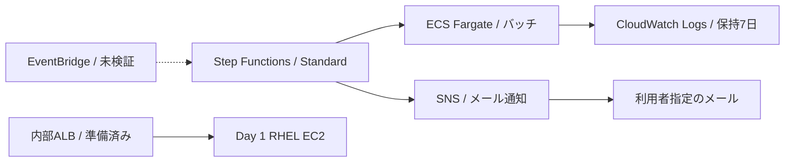

# Day 4：非同期連携・運用のコンソール実施記録

実施日：2026-10-28 ／ 東京（ap-northeast-1）／ 操作：AWSコンソール。

**実施中です。SNSとStep Functions → ECSバッチの成功・失敗通知は検証済みです。定期起動、監視・障害復旧、最終削除は未完了です。**

## 構成と検証済み範囲

バッチは公式Amazon Linuxイメージで5秒待機し、結果マーカーを出力するサンプルです。通常は終了コード0、`DEMO_FAIL=true` のときは終了コード42を返します。業務データを処理した実績としては扱いません。

## 確認済みの結果

| 項目 | 実測 |
|---|---|
| SNS | 専用Standardトピック、指定メールの購読確認済み、疎通確認発行成功 |
| ECS | 専用Fargateクラスター・タスク定義、0.25 vCPU / 0.5 GiB、常駐サービスなし |
| ネットワーク | バッチ用SGは受信0件、送信はTCP 443、既存Publicサブネット・パブリックIPを使用 |
| ログ | /portfolio/day4/batch、Standard、保持7日 |
| 成功実行 | day4-success-20261028-1729、17:30:05.120 → 17:30:59.069 JST、53.949秒 |
| 成功通知 | RunBatch成功 → 終了コード判定 → NotifySuccessのsns:publish成功 → ExecutionSucceeded |
| 意図的な失敗 | day4-failure-20261028-1737、17:36:51.442 JST終了、49.129秒 |
| 失敗の根拠 | States.TaskFailed、ECSのExitCode=42、EssentialContainerExited |
| 失敗通知 | Catch → NotifyErrorのsns:publish成功 → BatchFailed → ExecutionFailed |
| 実受信 | 疎通確認・SUCCESS・FAILUREの3通を、指定メールボックスの関連通知だけに絞った検索で確認 |

[検証要約JSON](../evidence/day4/batch-verification.json)と[定義・ポリシー例](../day4/README.md)を収録しています。時刻はコンソール表示とメールのDate情報に基づき、通知遅延の保証や負荷試験結果ではありません。

## 実行権限と定義

専用の `portfolio-day4-sfn-role` に、今回のバッチ定義・クラスター、SNSトピック、既存ECS実行ロールのPassRole、同期完了待機用のAWS標準EventBridgeルールに限った許可を付けました。同一アカウントの今回のステートマシンだけを信頼する条件を設けています。X-Rayと追加の実行履歴ログ配信はOFF、Standardの実行履歴で検証しました。

IAMはグローバルサービスなので、IAM管理画面はGlobal表示になります。実行リソースは東京に作成しています。[AWSのグローバルエンドポイントの説明](https://docs.aws.amazon.com/general/latest/gr/rande.html)を参照してください。

Step Functionsでは `ecs:runTask.sync` を使い、タスクの起動受付だけで終わらず完了を待機しました。成功応答時の終了コード判定に加え、今回の終了コード42による `States.TaskFailed` をCatchで通知する経路も確認できました。[公式のECS統合手順](https://docs.aws.amazon.com/step-functions/latest/dg/connect-ecs.html)を参照してください。

## Web監視の準備と現在の状態

Day 1のEC2を起動し、専用ターゲットグループと内部ALBを作成しました。HTTP:80 → EC2 Apache:80、ヘルスチェックは `/portfolio/`、15秒間隔・正常/異常とも連続2回、成功コード200です。ALBの受信には既存のVPC内HTTP用SGを使い、インターネット公開は行っていません。

ブラウザー接続が応答しなくなったため、この時点では以下が残っています。

| 項目 | 状態 |
|---|---|
| EC2 | 起動済み。終了時の停止は未実施 |
| Day 4 ALB・ターゲットグループ | 作成済み。最終の稼働・削除確認は未実施 |
| SNS・購読 | 保持中 |
| ECSクラスター・タスク定義・専用SG・ログ | 保持中。検証バッチは終了済み |
| Step Functions・専用ロール・専用ポリシー | 保持中 |
| EventBridge起動用ロール | 作成・付与の利用者承認済み、AWS上の作成は未実施 |
| EventBridge定期起動・EC2停止イベント通知 | 未実施 |
| CPU・ディスク・5xx通知アラーム、障害復旧、ダッシュボード、Logs Insights | 未実施 |
| 最終費用と追加分の削除 | 未完了 |

EC2とALBは稼働中のため費用が発生し得ます。Day 1の元EBS・EFS・スナップショット・S3、別の学習用 `training-*` リソースは今回の削除対象に含めません。Auroraは従来のFreeプラン維持方針により未作成です。

## 証跡の扱い

GitHubにはメールアドレス、アカウントID、実リソースID、ARN中の実アカウント部分、認証情報、購読確認・解除リンクを掲載しません。設定例の識別子は置換しています。画像のファイル書き出しは成功していないため、公開版の証跡は確認したコンソール状態と通知メールのメタデータをまとめたJSONです。画像を保存できたとは記載しません。

