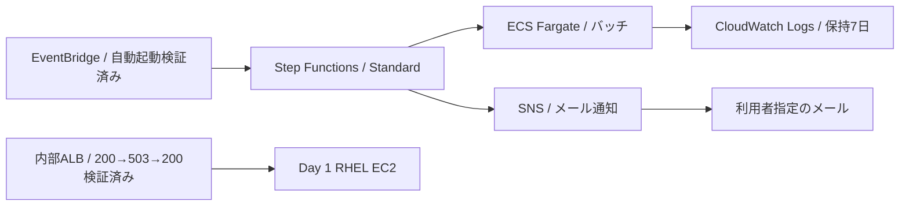

# Day 4：非同期連携・運用のコンソール実施記録

実施日：2026-10-28 ／ 東京（ap-northeast-1）／ 操作：AWSコンソール。

**実施中です。SNSとStep Functions → ECSバッチの成功・失敗通知は検証済みです。EventBridgeからの自動起動と通知も検証済みです。監視設定・Tomcat障害復旧・停止イベント通知・ダッシュボードを検証しました。最終削除と費用確定は未完了です。**

## 構成と検証済み範囲

バッチは公式Amazon Linuxイメージで5秒待機し、結果マーカーを出力するサンプルです。通常は終了コード0、`DEMO_FAIL=true` のときは終了コード42を返します。業務データを処理した実績としては扱いません。

## 確認済みの結果

| 項目 | 実測 |
|---|---|
| SNS | 専用Standardトピック、指定メールの購読確認済み、疎通確認発行成功 |
| ECS | 専用Fargateクラスター・タスク定義、0.25 vCPU / 0.5 GiB、常駐サービスなし |
| ネットワーク | バッチ用SGは受信0件、送信はTCP 443、既存Publicサブネット・パブリックIPを使用 |
| ログ | /portfolio/day4/batch、Standard、保持7日 |
| 成功実行 | day4-success-20261028-1729、17:30:05.120 → 17:30:59.069 JST、53.949秒 |
| 成功通知 | RunBatch成功 → 終了コード判定 → NotifySuccessのsns:publish成功 → ExecutionSucceeded |
| 意図的な失敗 | day4-failure-20261028-1737、17:36:51.442 JST終了、49.129秒 |
| 失敗の根拠 | States.TaskFailed、ECSのExitCode=42、EssentialContainerExited |
| 失敗通知 | Catch → NotifyErrorのsns:publish成功 → BatchFailed → ExecutionFailed |
| 実受信 | 疎通確認・SUCCESS・FAILUREの3通を、指定メールボックスの関連通知だけに絞った検索で確認 |

[検証要約JSON](../evidence/day4/batch-verification.json)と[定義・ポリシー例](../day4/README.md)を収録しています。時刻はコンソール表示とメールのDate情報に基づき、通知遅延の保証や負荷試験結果ではありません。

## 実行権限と定義

専用の `portfolio-day4-sfn-role` に、今回のバッチ定義・クラスター、SNSトピック、既存ECS実行ロールのPassRole、同期完了待機用のAWS標準EventBridgeルールに限った許可を付けました。同一アカウントの今回のステートマシンだけを信頼する条件を設けています。X-Rayと追加の実行履歴ログ配信はOFF、Standardの実行履歴で検証しました。

IAMはグローバルサービスなので、IAM管理画面はGlobal表示になります。実行リソースは東京に作成しています。[AWSのグローバルエンドポイントの説明](https://docs.aws.amazon.com/general/latest/gr/rande.html)を参照してください。

Step Functionsでは `ecs:runTask.sync` を使い、タスクの起動受付だけで終わらず完了を待機しました。成功応答時の終了コード判定に加え、今回の終了コード42による `States.TaskFailed` をCatchで通知する経路も確認できました。[公式のECS統合手順](https://docs.aws.amazon.com/step-functions/latest/dg/connect-ecs.html)を参照してください。

## Web監視の準備と現在の状態

Day 1のEC2を起動し、専用ターゲットグループと内部ALBを作成しました。HTTP:80 → EC2 Apache:80、ヘルスチェックは `/portfolio/`、15秒間隔・正常/異常とも連続2回、成功コード200です。ALBの受信には既存のVPC内HTTP用SGを使い、インターネット公開は行っていません。

接続復旧後、EventBridge専用ロールと定期起動ルールを作成しました。1分間隔で初回の起動を確認して無効化し、最終設定を `rate(1 day)` に変更しました。毎日24時間にわたる継続実行は未検証です。

自動実行は18:07:21.370 → 18:08:11.908 JST、50.538秒で成功しました。対応するSUCCESSメールもDate 09:08:11 UTCで確認しています。実行名の一致により、先の手動実行とは区別しています。

## 監視と障害復旧の実測

- CPU：`CPUUtilization >80`、5分×2回。ルートディスク：`disk_used_percent >80`、1分×2回。Day 1の実際のディメンションを複製し、専用SNS通知を追加しました。CPU・ディスクの意図的な閾値超過テストは未実施です。
- ALB：`HTTPCode_Target_5XX_Count`、Sum、1分、1/1データポイントで0超、欠損はnotBreaching。ALARMとOKの通知を設定しました。
- 正常時はALB経由でHTTP 200を5回、`PostgreSQL OK`を確認しました。
- 18:31:03 JSTにTomcatを停止。10秒おきの36回がHTTP 503でした。18:34:16 JSTのALARMメールを確認しました。
- Tomcat再起動後、18:37:14 JSTにHTTP 200・DB接続・httpd/Tomcat/PostgreSQLのactiveを確認し、`FAULT_RECOVERY=PASS`で終了しました。スクリプトにはEXIT時のTomcat起動処理を入れています。
- 18:31:16 JSTのOKメールは初期のデータ不足→OK遷移です。障害からの復旧通知とは区別し、復旧後のOKメールは別途確認します。
- EC2停止をコンソールから実行し、18:39:23 JSTの「stopped」イベント通知を指定メールで確認しました。対象はDay 1のEC2 1台と停止状態に限定しています。
- `portfolio-day4-operations`を保存。EC2 CPU・ディスク、ALBリクエスト/5xx、Step Functions成功/失敗、SNS配信、ECSバッチログを表示しました。ログウィジェットのLogs Insightsクエリは6行（成功2件・失敗1件と開始マーカー）を返しました。Auroraと常駐ECSサービスは今回未作成のため、それらの実測パネルは含めていません。

[運用検証JSON](../evidence/day4/operations-verification.json)を参照してください。SNSは既存所有者権限に加え、同一アカウントのDay 4アラームと指定EC2停止ルールだけに発行を許可しました。EventBridgeコンソールが自動追加した条件なしの重複許可は除去し、限定した設定を保存しました。

## 終了状態と残作業

この時点では以下が残っています。

| 項目 | 状態 |
|---|---|
| EC2 | コンソールから停止実行済み。stoppedイベントのメール到達確認済み |
| Day 4 ALB・ターゲットグループ | HTTP 200→503→200を検証済み。削除は未実施 |
| SNS・購読 | 保持中 |
| ECSクラスター・タスク定義・専用SG・ログ | 保持中。検証バッチは終了済み |
| Step Functions・専用ロール・専用ポリシー | 保持中 |
| EventBridge起動用ロール | 作成済み。専用インラインポリシーで今回のワークフロー開始のみ許可 |
| EventBridge定期起動 | 自動起動・成功・メール受信を検証済み。毎日設定、無効化済み |
| EC2停止イベント通知 | 作成・実受信確認済み |
| CPU・ディスク・5xx通知アラーム、障害復旧、ダッシュボード、Logs Insights | 設定済み。5xx障害通知とアプリ復旧を実測。復旧OKメールは確認待ち |
| 最終費用と追加分の削除 | 未完了 |

EC2の停止イベントは確認済みです。ALB、残したストレージ・ログ等には費用が発生し得ます。費用画面を開く際にChrome操作接続が切れ、削除と最終費用確認は残っています。Day 1の元EBS・EFS・スナップショット・S3、別の学習用 `training-*` リソースは今回の削除対象に含めません。Auroraは従来のFreeプラン維持方針により未作成です。

## 証跡の扱い

GitHubにはメールアドレス、アカウントID、実リソースID、ARN中の実アカウント部分、認証情報、購読確認・解除リンクを掲載しません。設定例の識別子は置換しています。画像のファイル書き出しは成功していないため、公開版の証跡は確認したコンソール状態と通知メールのメタデータをまとめたJSONです。画像を保存できたとは記載しません。

