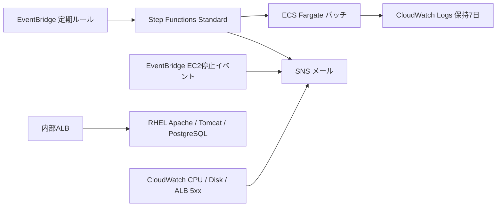

# Day 4：Terraformによる再現・検証・終了記録

実施日：2026-10-29（東京 / ap-northeast-1）。[コードと再現手順](../terraform/day4/README.md) / [検証要約](../evidence/terraform-day4/verification.json) / [終了照合](../evidence/terraform-day4/final-cleanup.json)。

**コンソールで実施したDay 4の範囲をTerraformで再構築し、バッチ・通知・定期起動・障害復旧を再検証しました。追加24リソースを削除し、EC2停止と元データの保持を確認しています。**

## 再現した構成

TerraformはDay 4専用のstateを使い、24リソースを管理しました。Day 1のVPC・EC2・サブネット・SG・既存ECS実行ロールは参照のみです。EC2の起動/停止、ワークフロー実行、SSMによる障害演習、メール購読の本人確認はTerraformの宣言的リソースとは分け、補助スクリプトと利用者の操作で行いました。

バッチは公式Amazon Linuxイメージを使う結果マーカー出力のサンプルです。常駐ECSサービスやAurora、NAT Gateway、NLBは作成していません。受信なし・HTTPS送信のみのSGとPublic IPでイメージを取得します。

## 実測結果

| 項目 | 結果 |
|---|---|
| fmt / validate | 成功 |
| 実行計画 | 新規24件のみ。既存基盤の変更・削除なし |
| 構築後・検証後の通常plan | No changes、終了コード0 |
| 成功バッチ | 11:28:28.954 → 11:29:20.251 JST、SUCCEEDED、SNS発行成功 |
| 意図的な失敗 | 11:29:27.953 → 11:30:15.768 JST、終了コード42、FAILED、Catch側のSNS発行成功 |
| EventBridgeからの実行 | 11:29:25.961 → 11:30:15.476 JST、入力trigger=EventBridge、SUCCEEDED |
| 定期ルール終了設定 | 1分間隔で検証後、Terraformでrate(1 day)・DISABLEDへ復帰 |
| 障害演習 | 11:28:35 → 11:34:45 JST、Tomcat停止中503×36、再起動後200・DB接続・サービスactive確認 |
| 5xx通知メール | ALARM 11:31:05 JST、OK 11:43:05 JST |
| Logs Insights | Complete、6行。成功/失敗・開始マーカーを取得 |
| EC2停止通知メール | 12:03:18 JST、専用ルールと停止メッセージが一致 |
| 最終AWS照合 | 12:05:52 JST、Day 4対象すべて0件、既存EC2 stopped |
| 削除後 | 管理対象0件、destroy planも差分0・終了コード0 |

バッチの成功・失敗・自動起動は実行名を照合して3通のメール受信を確認しました。5xxのALARM/OKとEC2停止通知も含め、6通の関連通知を指定メールボックスで確認しています。時刻は実行履歴とメールDate情報に基づき、メール配送遅延を保証する値ではありません。

アプリ復旧はHTTP/DB応答で確認しています。アラームの欠損データはnotBreachingのため、遅れて届いたOK通知だけをアプリ復旧の根拠とはしません。CPU・ディスクの意図的な閾値超過試験や24時間の日次反復は未実施です。

## 実装と修正

- ASLテンプレートにTerraformが作成したタスク定義ARNを渡します。コンソール時のリビジョン1を固定せず、今回のリビジョン2で検証しました。
- Step Functions用とEventBridge用のIAMロールを分け、タスク・クラスター・トピック・ワークフロー・信頼元を限定しました。今回は専用インラインポリシーとして管理しています。
- SNS所有者権限の `SNS:*` はAWS APIに「action out of service scope」として拒否されたため、対応する8操作を明示しました。途中まで作成されたstateを保持し、残り2件を再計画・適用して完成させました。修正後と最終検証後の通常planで差分0を確認しました。
- 定期起動の補助スクリプトは変更先を定期ルール1件に限定し、finallyで日次・無効設定へ戻します。
- 障害演習はSSM経由で実行し、EXIT時のTomcat起動処理を設けました。
- AWS providerは6.70.0へ固定。タスク定義の削除は、プロバイダーによる登録解除後に、このstateから保存した正確なリビジョンだけを削除します。

## 終了状態

保存した削除計画をDay 4の24アドレスの許可リストに照合して適用しました。AWS APIでALB/TG、ECSクラスターとACTIVE/INACTIVEタスク定義、Step Functions、EventBridge、SNSトピック/購読、アラーム、ダッシュボード、ログ、SG、専用IAMロールが残っていないことを確認しました。

元のEC2はstopped、VPCはavailable、EBSは2個接続されたままです。元DB用EBSはin-use、元EFSはavailable、元スナップショットはcompletedを確認しました。S3証跡、既存の共有ECS実行ロールや共有AWS管理ルール、別の学習用リソースは削除対象に含めていません。

保存領域の料金は継続し得ます。Day 4単独の確定費用は未集計です。今回の実行にも利用者が更新した既存rootセッションを使いました。日常作業は必要な権限に限定した作業用ロールへ移すことが改善点です。

公開するのはコード・置換済みの設定例と要約証跡です。state、plan、実値のtfvars、メールアドレス、認証情報、生の実行履歴は非公開領域へ分離しています。
