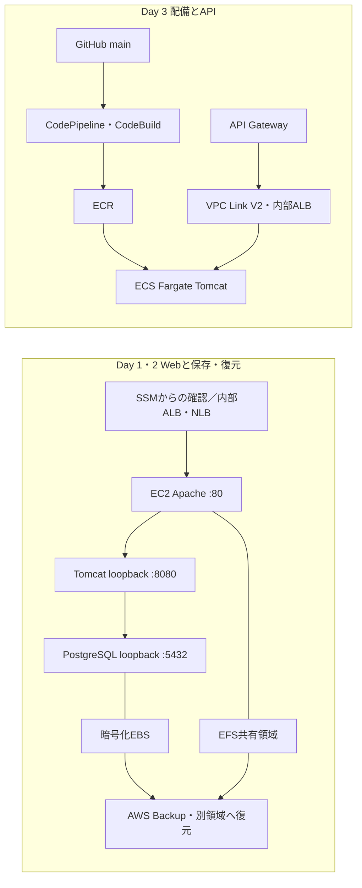
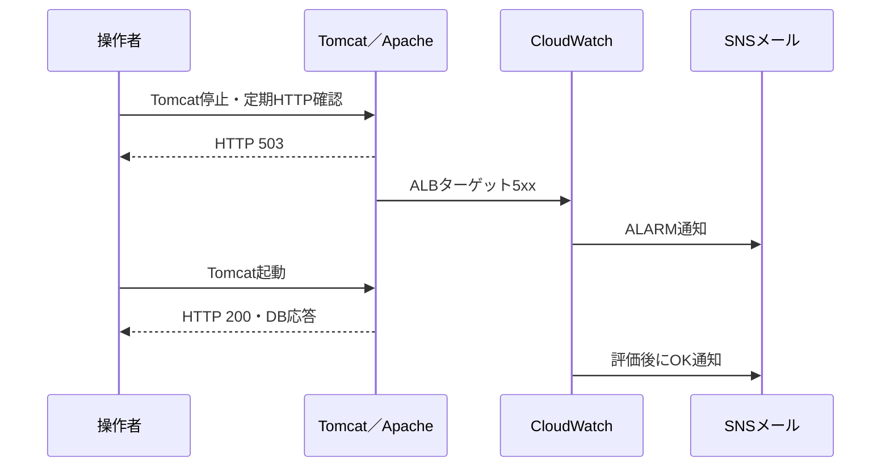

# 基本設計書

文書ID：BAS-01／版：1.0／作成日：2026-10-29／状態：レビュー用・事後整理。

本書は学習環境の実装と検証記録から設計意図を整理したものです。顧客承認済みの設計書ではありません。[要件定義書](requirements.md)・[詳細設計書](detailed-design.md)・[試験仕様書兼結果書](test-specification-results.md)と併せて参照してください。

## B01 対象範囲と段階構成

各段階で検証対象を作成・削除する。以下は同時稼働する一つの完成環境ではない。

| 段階 | 実装した主経路 | 対象外・制約 |
|---|---|---|
| Day 1 | SSM経由の確認 → Apache → Tomcat → EC2内PostgreSQL | EC2は1台。インターネット向けWeb公開なし |
| Day 2 | 内部ALB／内部NLB → EC2のApache → Tomcat → PostgreSQL | NLBも80番。Aurora移行・複数台フェイルオーバーは未実施 |
| Day 3 | 公開REST API → VPC Link V2 → 内部ALB → Fargate Tomcat | コンテナのDB接続は未設定。Day 2のNLBは使用しない |
| Day 4 | EventBridge → Step Functions → Fargate単発タスク → SNS | Webとは別のバッチ。検証後は定期起動を無効化・削除 |

## B02 ネットワーク設計

東京リージョンのVPC `10.40.0.0/16` に2AZ・パブリック2／プライベート2サブネットを配置する。パブリック側のみIGWへの既定経路を持つ。NAT Gatewayは作成しない。プライベート側から一般インターネットへ出る経路はない。

EC2およびFargateは、パッケージやイメージ取得のためパブリック側でパブリックIPを利用する。受信はSGで制限する。内部ALBをパブリックサブネットに置いても、ALB自体がインターネット公開される設定ではない。VPC Linkはプライベート側を利用する。

Day 3だけAPI GatewayのGETを公開する。HTTPSはAPI Gateway入口までで、内部ALB・アプリ間はHTTPである。内部通信のTLS化は改善事項とする。

## B03 セキュリティ・管理設計

管理接続はSSMを使用し、SSHを開放しない。EC2のIMDSv2を必須とし、SELinuxはEnforcingを維持する。S3は非公開・保存時暗号化・HTTPS必須とする。DBはloopback待受とし、アプリ用利用者に参照権限を与える。

CI/CD・Step Functions・EventBridgeは用途別のIAMロールを持つ。対象リポジトリ、成果物プレフィックス、SNSトピック等を限定する。一部操作はAWS仕様上リソースを限定できないため、操作・呼出元条件を併用する。実際の作業でroot認証を使用した箇所があり、運用者の最小権限化・顧客向け権限分離が完成した環境とは扱わない。

APIキーは利用量管理用であり、利用者本人の認証を実装するものではない。EFSのNFS通信暗号化、内部HTTPのTLS化、Secrets Managerへの移行、利用者認証は未実施とする。

## B04 アプリ・データ・ストレージ設計

Day 1・2のJSPはPostgreSQLの検証用テーブルを参照する。DBのデータ領域は追加EBSに分離し、OS再起動後もUUIDによるマウントとDB起動で継続利用する。EFSは共有ディレクトリの接続とファイル保存を確認する。複数クライアントからの同時利用は確認していない。

S3は静的ファイル・ログ・成果物の非公開保存先とする。公開Webサイト機能は使用しない。Day 3のWARはリリース識別情報を返し、パイプラインが届けた内容を検証する。コンテナへのDB設定は未投入で、`DB_STATUS=UNCONFIGURED` が正しい検証結果となる。

## B05 バックアップ・復元設計

DBのEBSとEFSをAWS Backupの対象にする。オンデマンド取得後、元データを上書きせず別EBS・別EFSへ復元する。EBSは停止後に取得したデータを別ポートの一時DBで照会し、EFSは読み取り専用で元ファイルと比較する。

バックアップジョブ完了だけで復旧可能とは判断しない。SQL結果・ファイル内容の一致までを合格条件とする。日次・7日保持の設定は作成したが、7日間の世代運用、時点復旧、業務RPO/RTOは検証対象外である。Auroraのバックアップは実施していない。

## B06 コンテナ・CI/CD設計

GitHubの対象リポジトリをソースとし、mainのDay 3対象変更をCodePipelineで取り込む。CodeBuildがMavenでWARを作り、Docker起動後に実際の画面内容を確認し、ECRへ保存する。ECS標準デプロイで新しいタスク定義へ更新する。

ヘルスチェック成功だけでは配備完了としない。API経由のHTTP 200、リリース名、ビルド元コミットの一致を確認する。過去にヘルスチェック200でもJSPが500となったため、本文検証とエラー時のビルド停止を加えた。CodeDeployは定義ファイルの準備までで、実配備は未実施である。

## B07 バッチ・イベント設計

Standard型Step FunctionsがECSの`runTask.sync`でタスク完了を待つ。成功時はSNSへ成功を通知し、起動・実行エラーや終了コード異常はエラー通知後にワークフローを失敗させる。失敗を通知しただけで成功扱いにしない。

通常のスケジュールは1日ごと・無効。検証中だけ1分ごとに変更し、実行入力からEventBridge起動を確認した。EC2の停止イベントは別ルールでSNSへ送る。メール購読は利用者による確認が必要である。

## B08 監視・通知設計

EC2は標準CPUに加え、CloudWatch Agentでメモリ・ディスク・アプリログを送る。ALBのターゲット5xxを障害検知に使用する。ログ保持は7日とし、Day 4ではダッシュボードとLogs Insightsを追加する。

Day 1・2はアラーム状態の確認まででSNS通知先を接続していない。Day 4でCPU・ルートディスク・ALB 5xxの通知を接続し、Tomcat停止で5xxのALARM・OKメールを確認した。CPU・ディスクの閾値超過は実演していない。

アプリ応答の復旧時刻とアラームOKの時刻は一致しない。通知評価の遅延を含むため、観測時間を保証RTOに転用しない。

## B09 運用・費用・終了設計

開始前に認証、リージョン、元リソース、バックアップ、課金対象を確認する。障害演習には復旧処理を組み込み、終了時にサービスの稼働を確認する。検証後は追加LB・タスク・定期ルール等を削除し、元EC2を停止する。

Day 1のEBS・EFS・スナップショット・S3証跡と共有ロール等を残す。EC2停止だけで保存領域の課金がなくなるわけではない。既存の空のDay 2 Backupプランも残る。4日分の正確な費用は未確定であり、当初の概算やクレジットを実績として記載しない。

## B10 IaC・変更管理設計

TerraformはDay 1の既存基盤取込み、Day 2の同一state内の追加検証、Day 3・4の独立した追加環境に分ける。Day 2で基盤全体のdestroyを実行しない。復元ジョブの実行や動的タスク定義の整理など、Terraform以外の補助操作も記録する。

Day 3はECSタスク定義の配備更新をパイプラインが担う。Terraformの差分無視には、この所有分担を反映する。コード、実行結果、検証結果を対応付け、state・実値変数・認証情報を公開しない。

## B11 設計判断・残課題

| 判断 | 採用理由 | 制約・今後の判断材料 |
|---|---|---|
| 単一EC2・Fargate通常1タスク | 短期間で接続と配備を説明・検証する | HA、容量、障害切替は別設計・試験が必要 |
| NATなし・必要な実行環境に公開IP | 学習費用を抑え外部取得を可能にする | 本番では閉域化・VPC Endpoint・経路費用を再評価 |
| 内部ALBとAPI Gateway | 内部アプリへ管理した入口を設ける | APIキーだけでは認証要件を満たさない |
| Aurora・CodeDeployを保留 | 当該アカウントのFree維持という判断 | 現在の提供条件を確認し、承認後に別検証 |
| 選択的削除と基盤保護 | 元データと証跡を維持する | 保存費用が残るため保管期限の合意が必要 |

本番適用には、SLA・RTO/RPO・処理量・個人情報・認証・監査・運用体制・費用上限を顧客と合意し、構成と試験項目を更新する。[未実施項目](test-specification-results.md#未実施項目と追加試験)を参照。
